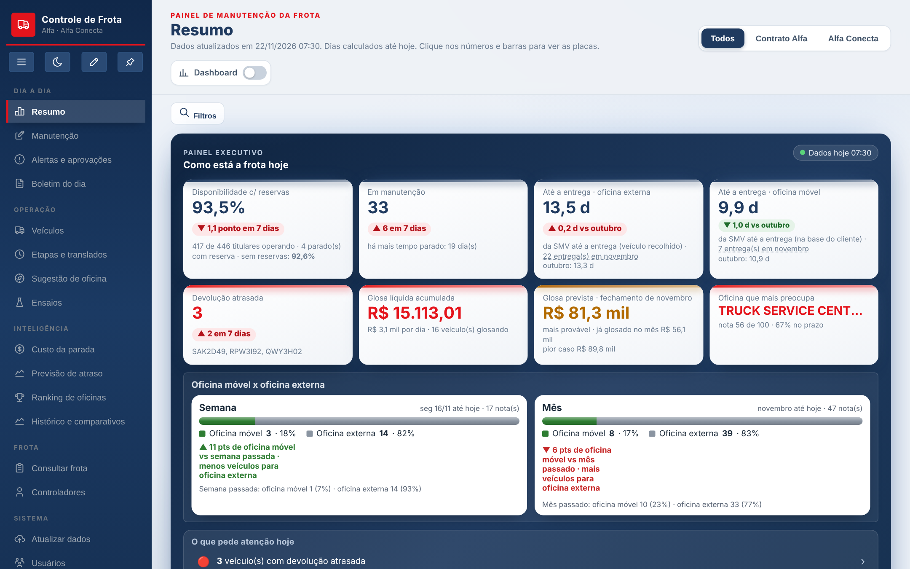
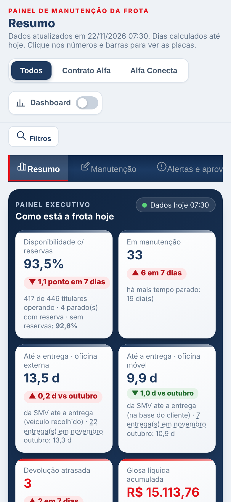
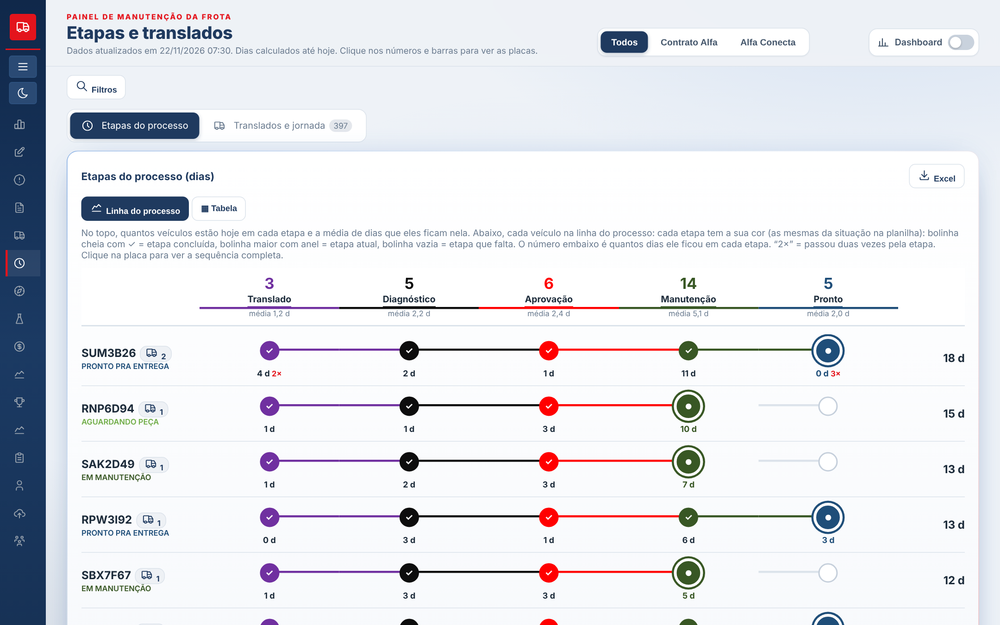
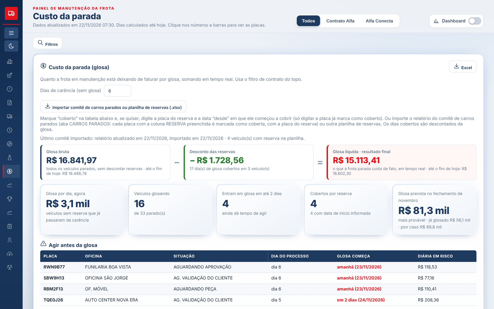
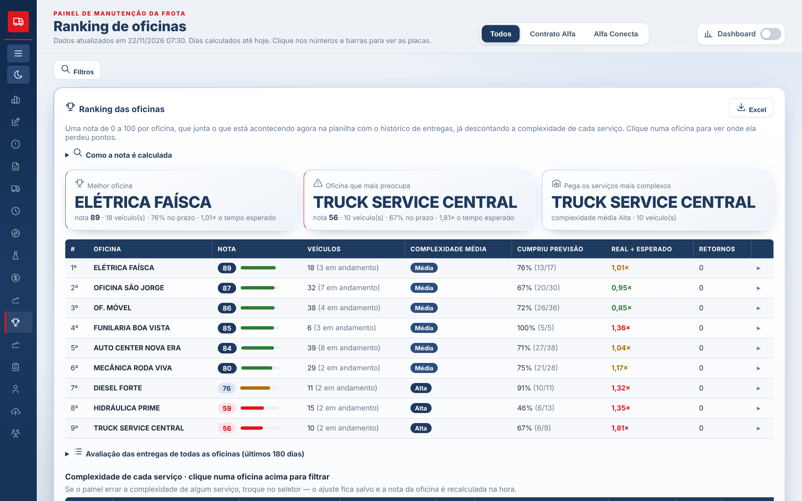
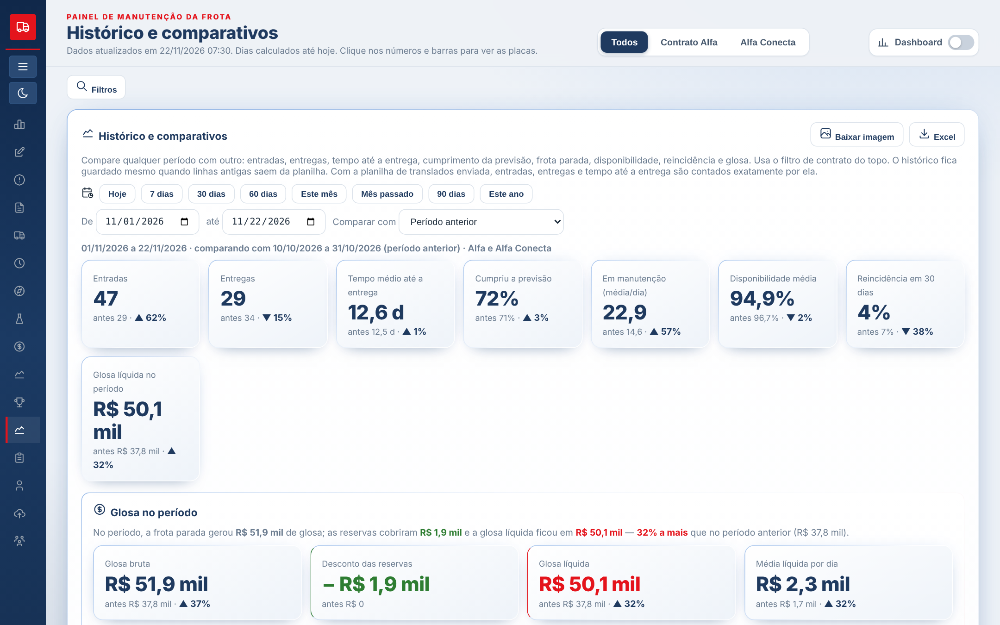
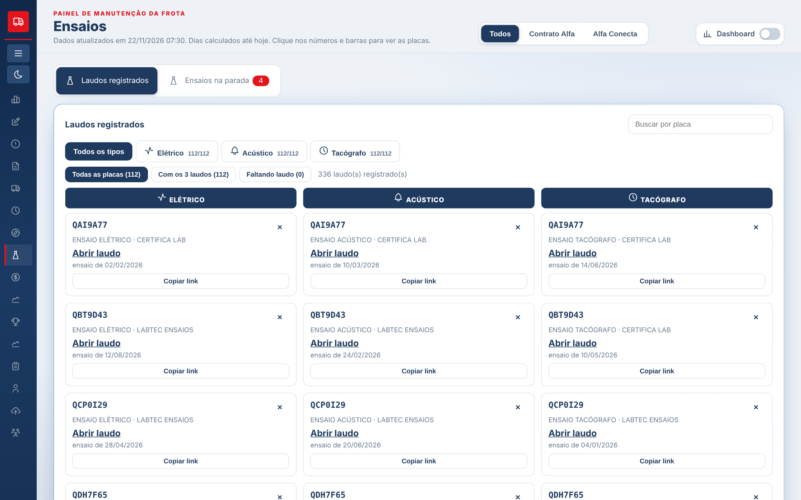

# Painel de Manutenção da Frota · demonstração

Sistema web para controlar a manutenção de uma frota de veículos leves e pesados. Ele substitui a planilha de controle: cada veículo parado tem a sua linha do processo (translado, diagnóstico, aprovação, manutenção, peça, pronto e entrega), e os painéis calculam na hora a disponibilidade da frota, o custo da parada, o atraso das oficinas e o histórico de cada período.

Uso este sistema no meu dia a dia como controlador de frota. Esta é a versão de demonstração: **o código é o mesmo, mas todos os dados são fictícios**.

**Demonstração:** link em breve (pode mexer à vontade; as alterações ficam só no seu navegador e o botão "Restaurar dados" volta ao início)



<p align="center">
  
</p>

## Funcionalidades

- **Resumo (painel executivo)**: disponibilidade da frota com e sem reservas, veículos em manutenção, tempo médio até a entrega (oficina externa x oficina móvel), devoluções atrasadas, glosa acumulada e prevista para o fechamento do mês, e a lista do que pede atenção hoje.
- **Manutenção**: a planilha de controle dentro do sistema. Visão em linha do processo ou em tabela, ficha de cada veículo com o diário de observações, filtros e avisos prontos (previsão vencida, entra em glosa amanhã, sem atualização há 3 dias, orçamento parado), colar linhas direto do Excel e exportar no mesmo formato da planilha.
- **Alertas e aprovações** e **Boletim do dia**, com o texto pronto para enviar no WhatsApp.
- **Etapas e translados**: quantos dias cada veículo ficou em cada etapa e quantas vezes passou por ela, lido automaticamente das observações (ex.: voltou do ensaio para a oficina). Histórico de todos os translados com origem, destino e código.
- **Sugestão de oficina**: mapa com bases e oficinas; compara o tempo de translado, a fila atual e o tempo que cada oficina costuma levar para liberar.
- **Ensaios**: laudos por placa (elétrico, acústico e tacógrafo) e ensaios vencidos que podem ser feitos durante a parada.
- **Custo da parada**: glosa em tempo real com dias de carência configuráveis, desconto dos dias cobertos por reserva e previsão para o fechamento do mês.
- **Previsão de atraso**: estimativa de saída de cada veículo pela curva de liberação de cada oficina (Kaplan-Meier) e pelo desvio das previsões anteriores.
- **Ranking de oficinas**: nota de 0 a 100 que junta prazo, tempo real ÷ tempo esperado e retornos, ajustada pela complexidade de cada serviço.
- **Histórico e comparativos**: qualquer período contra outro (entradas, entregas, tempo até a entrega, previsão cumprida, disponibilidade, reincidência e glosa), com exportação em imagem e Excel.
- **Frota e controladores**: consulta da base de frota, titulares e reservas por controlador.

<p align="center">
  
  
  
  
  
  
</p>

## Tecnologias

| Parte | Escolha |
|---|---|
| Interface | HTML, CSS e JavaScript puros, sem framework e sem etapa de build |
| Planilhas | [SheetJS](https://sheetjs.com) para ler e gerar arquivos do Excel |
| Mapas e rotas | OpenStreetMap e OSRM |
| Versão em produção | Função serverless em Node.js na Vercel, banco Upstash Redis, login com cookie assinado (HMAC), senhas com scrypt e limite de tentativas, backup diário por e-mail |
| Esta demonstração | Site estático; roda só no navegador |

### Na versão em produção (fora desta demonstração)

- **Perfis de acesso**: controlador (edita os próprios veículos), gestor (vê tudo, sem editar) e cliente (só visualiza e extrai relatórios). Cada controlador tem o seu espaço, e o gestor vê o consolidado.
- **Sincronização com o Excel online**: um script dentro da planilha leva para o Excel o que foi editado no painel e traz para o painel o que foi editado na planilha.
- **Cópia de segurança automática** todos os dias no fim do expediente.

## Sobre os dados desta demonstração

Os dados são gerados no navegador pelo arquivo `seed.js`, com datas relativas ao dia de hoje, para a demonstração sempre parecer atual. Cliente ("Alfa"), placas, números de ordem, oficinas, bases, pessoas, valores de locação e laudos são inventados. As regras de cálculo (carência da glosa, reservas, retrabalho e disponibilidade) são as mesmas da versão real.

## Estrutura

```
index.html                o painel
seed.js                   dados fictícios da demonstração
laudo.html                exemplo de laudo aberto pela aba Ensaios
vendor/xlsx.full.min.js   SheetJS (licença Apache 2.0)
docs/                     imagens deste README
```

Para rodar no computador, basta abrir o `index.html` no navegador ou usar `npx serve .`.

## Créditos

Projeto de [Rodrigocastro92](https://github.com/Rodrigocastro92). Código escrito com apoio de IA (Claude, da Anthropic); as regras, as telas e os testes foram definidos a partir do uso real no controle de manutenção da frota.

---

## English summary

**Fleet Maintenance Dashboard** is a web app that replaces a maintenance-control spreadsheet for a fleet of light and heavy vehicles. Each vehicle in the shop gets a process timeline (pickup, diagnosis, approval, repair, parts, ready, delivery), and the dashboards compute fleet availability, downtime cost (contract penalties with a grace period and backup-vehicle coverage), workshop delays and rankings adjusted by job complexity, Kaplan-Meier release forecasts and period-over-period history. Built with vanilla HTML/CSS/JS in a single file, SheetJS for Excel import/export, OpenStreetMap/OSRM for maps and routes. The production version runs on a Node.js serverless function on Vercel with Upstash Redis, signed-cookie login, scrypt-hashed passwords, role-based access and daily backups. This repository is a static demo with generated sample data.
